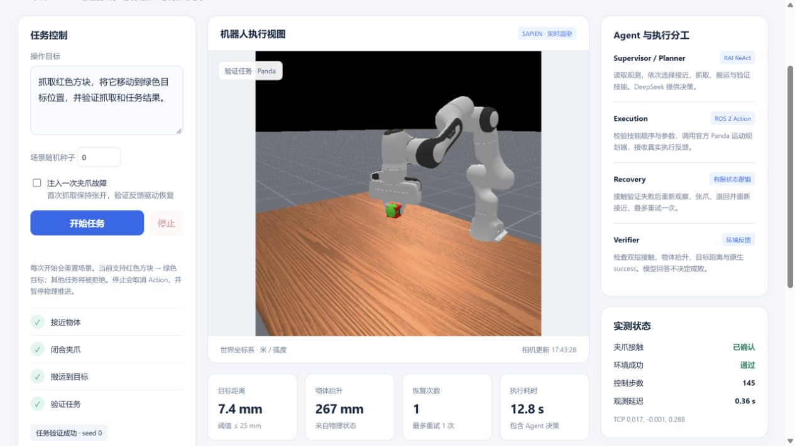

# RoboWeave — RAI / ROS 2 Manipulation & Recovery

RoboWeave turns a natural-language manipulation task into **real ROS 2 skill calls,
Panda arm motion, contact feedback, native task verification and bounded recovery**.
The primary demonstration now runs **ManiSkill / SAPIEN PickCube**.

**[Open the live arm demo](https://wedding-transcript-visitors-ultram.trycloudflare.com)**
— HTTPS with a separately supplied access code. This temporary Quick Tunnel
hostname may change or expire; no permanent domain has been configured.



## What actually runs

```text
Task → RAI ReAct / DeepSeek → validated ordered tools
                                 ↓
                /roboweave/arm/manipulate ROS 2 Action
                                 ↓
                Panda motion planner → SAPIEN physics
                                 ↓
                joint / TCP / cube / contact feedback
                                 ↓
                native verifier → success / bounded recovery
```

- **Planner:** upstream RAI ReAct reads observations and selects `approach`,
  `grasp`, `transport`, `verify`, one at a time. Only this task family is supported.
- **Executor:** RAI `ROS2Connector` invokes a native ROS 2 Action with goals,
  feedback, results, deadlines and cancellation. One separate thread owns physics.
- **Recovery:** the test physically keeps the fingers open on the first grasp.
  Contact verification fails and the Action returns ABORTED(6). The runtime
  re-observes, retracts/reapproaches and retries once. Unknown execution state,
  timeout and cancellation do not automatically retry.
- **Verifier:** actual contact, measured lifting, stationary robot, target distance
  ≤ 25 mm and native environment `success` determine the verdict, not LLM prose.
- **Logger / dashboard:** every commanded action and measured state is recorded;
  the UI displays sampled real rendered frames, metrics and execution events.

This is **one LLM planner plus deterministic execution, recovery and verification
roles**, not three independent LLM agents.

## Actual validation

| Check | Observed result |
|---|---|
| Unmodified official `pick_cube.solve`, seed 0 | Native success, contact and stationary verdict all true |
| RAI → ROS 2 → Panda, seeds 0 and 1 | All four skills succeeded in both scenes |
| Physically open-gripper fault | Contact false → ABORTED(6) → one recovery → success |
| External authenticated HTTPS task | Full fault/recovery task succeeded |
| Invalid skill | Native ROS goal rejected |
| Deadline / cancellation | ABORTED(6) / CANCELED(5); physics steps and joints unchanged after cancellation |
| Regression and guard tests | 69 passed, including 57 existing upstream-related checks |
| Browser | Real frame displayed; start/stop used; state and timeline updated |

The recorded public recovery task took **12.78 s**, with approximately **7.4 mm**
target error and **267 mm** cube lift. These are individual engineering records,
not benchmark success rates or proof of general manipulation capability.

Receipts: [public recovery](docs/evidence/arm/public-verification.json),
[normal seed 0](docs/evidence/arm/normal-seed0.json),
[normal seed 1](docs/evidence/arm/normal-seed1.json),
[ROS boundaries](docs/evidence/arm/boundaries.json),
[official baseline](docs/evidence/arm/official-baseline.json).

The official planner initially segfaulted with NumPy 2.2.6. An isolated NumPy
1.26.4 override repaired the same reproduction, consistent with
[upstream issue 1100](https://github.com/mani-skill/ManiSkill/issues/1100).
The original benchmark environment was preserved. Reset now advances physics
before publishing contact evidence to clear previous-episode contact buffers.

## Run

Verified server project: `/data/projects/rai-roboweave`. In the prepared workspace:

```bash
bash scripts/start_roboweave_arm.sh
python3 scripts/verify_roboweave_arm.py --seed 0
python3 scripts/verify_roboweave_arm.py --seed 0 --fault
```

Runtime: `127.0.0.1:8770`; authenticated gateway: `127.0.0.1:8771`;
simulator: `127.0.0.1:8772`; ROS domain: 74. systemd and Docker supervise the
services. Only the authenticated gateway is tunneled. Raw control ports are private.

See [deployment, tests and hardware migration](docs/arm-deployment.md).
The deployed project-local `.venv-arm` reuses reviewed installed dependencies
read-only with a local NumPy override. A clean-machine standalone install and
a new full image build remain **unverified**.

## Code map

| Path | Responsibility |
|---|---|
| `roboweave/arm/runtime.py` | RAI tools, ordered skills, recovery and receipts |
| `roboweave/arm/ros_adapter.py` | Native Action lifecycle and measured state |
| `roboweave/arm/sim_worker.py` | Official planner, physics, frames and trajectories |
| `roboweave/arm/contracts.py` | Parameter and native postcondition validation |
| `src/roboweave_interfaces/action/Manipulate.action` | Skill / feedback / result contract |
| `roboweave/arm/index.html` | Live arm dashboard |
| `roboweave/public_gateway.py` | Authentication, route allowlist, Origin checks |
| `scripts/verify_roboweave_arm.py` | HTTP → LLM → ROS → physics integration checks |
| `scripts/verify_arm_boundaries.py` | Rejection, timeout and cancel checks |

## Hardware transfer and limits

This is real 3-D robot **simulation**, not physical robot deployment. The official
motion planner uses privileged object geometry/state; it is not a vision-driven
policy or learned VLA. The cube is moved to the target and **held**, not released.
Physics pauses between skills. DeepSeek runs through a remote API.

Keep the RAI layer and ROS contract; replace the simulator adapter with the robot
driver / MoveIt implementation. Real deployment still requires perception,
calibration/TF, target mapping, workspace/collision limits, command watchdog,
independent emergency stop and measured postcondition thresholds. Simulator
cancellation does not establish physical stopping safety. No hardware, Jetson/ARM,
offline onboard inference or long-horizon LIBERO result is claimed.

The previous turtlesim code and evidence remain in
[the 2-D baseline](README.turtlesim.md). Its service and the existing OpenETA
assets were preserved; the arm demonstration is the new primary entry.

## Provenance

Based on [RobotecAI/RAI](https://github.com/RobotecAI/rai), commit
`b018729833742c6f71e1e9f332ee2b435676fb4f`. Upstream Git history, source, examples
and Apache-2.0 license remain. [Original README](README.upstream.md).
Vendored [rai_interfaces](https://github.com/RobotecAI/rai_interfaces) remains pinned
to `f03dc0f217679980447dfead177979f485eb44f6` with its license.
Manipulation imports [ManiSkill's official Panda planner](https://github.com/mani-skill/ManiSkill/tree/main/mani_skill/examples/motionplanning/panda).

CI checks Python, shell, frontend JavaScript and pure contracts. Live ROS,
rendering and LLM tests require the prepared server and are reported separately.
API keys, share passwords and raw provider logs are excluded from GitHub.
