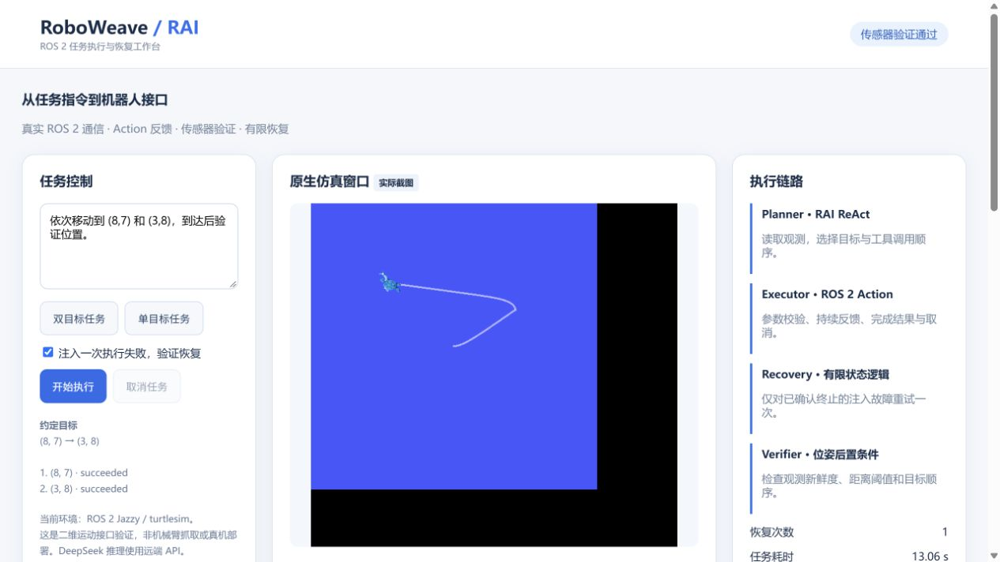

# RoboWeave — RAI / ROS 2 Execution & Recovery

RoboWeave turns a natural-language task into **real ROS 2 skill calls, execution feedback, sensor verification, and bounded failure recovery**. It provides a concrete execution-layer prototype for later robot integration.

**Current scope:** ROS 2 Jazzy + turtlesim planar motion. Physical robots, arm manipulation, collision-aware navigation, ARM/Jetson deployment and onboard/offline LLM inference have **not** been validated. DeepSeek currently runs through a remote API.



## What actually runs

```text
Task → RAI ReAct / DeepSeek → validated skill → ROS 2 Action
                                             ↓ feedback / result
                            turtlesim ← Twist controller
                               ↓ Pose
                         sensor verifier → success / bounded recovery
```

- **Planner:** upstream RAI ReAct chooses tools from live observations and an ordered coordinate task.
- **Executor:** `ROS2Connector` calls `/roboweave/move_to_pose`, with typed goals, feedback, results and cancellation.
- **Recovery:** only a confirmed, aborted injected transient failure gets one re-observation and retry. Cancellation, timeout, stale observations and unknown execution state do not automatically retry.
- **Verifier:** measured position and observation age determine success; LLM prose cannot override the verdict.
- **Shared state / trajectory:** per-task events, Agent messages, actual pose trajectory and final results are persisted.
- **Dashboard:** native simulator screenshots, current pose, actual event timeline and task history, with an authenticated allowlisted presentation gateway.

These are one LLM planner and deterministic execution/recovery/verification modules, not three independent LLM agents.

## Evidence

| Check | Observed result |
|---|---|
| Unmodified official `examples/agents/react_ros2.py` | Native RotateAbsolute action completed; status 2 → 4, 75 changed poses, 29 HRI response chunks; requested theta 1.2, measured 1.184 rad |
| Ordered two-goal task | Both sensor postconditions passed, 12.26 seconds in the recorded run |
| Injected failure | Native ABORTED(6), re-observation, one retry, task succeeded |
| Cancellation | Native CANCELED(5), final linear and angular velocity zero |
| Invalid goal / deadline | Out-of-bounds goal rejected; timeout aborted with 21 feedback samples, then zero velocity |
| Public HTTP task | Authenticated task completed; unauthenticated API 401, cross-origin command 403, disallowed path 404 |
| Targeted tests | 57 upstream-related tests + 3 application guard tests = **60 passed** |
| Restart | Simulator feedback recovered after container restart; UI recovery task succeeded again |

These are engineering checks and individual execution records, not benchmark success rates. See [machine-readable evidence](docs/evidence/verification.json) and the [normal](docs/evidence/normal-events.jsonl), [recovery](docs/evidence/recovery-events.jsonl), and [cancellation](docs/evidence/cancel-events.jsonl) event traces.

An early stale-observation failure exposed Python ROS executor scheduling delays. The application now uses a single-threaded callback executor and a separate motion worker, preserving the one-second observation threshold. A stale X11 lock after container restart was also reproduced and repaired. The serving process supervises its essential children.

## Run

The verified installation uses Linux x86_64, ROS 2 Jazzy, Python 3.12, a project-local `.venv`, and the upstream `uv.lock`. This 2D demonstration does not require a GPU.

See [deployment instructions](docs/roboweave-deployment.md) for the tested prepared-workspace commands and the new clean-build Docker recipe. **A second clean-machine image build has not yet been verified.** The existing cloud deployment is running; publication does not replace or restart it.

Public demonstration: [RoboWeave RAI](https://resort-catherine-continent-tackle.trycloudflare.com). Access requires a separately supplied password. This is a temporary Quick Tunnel hostname and may change or expire; credentials are never included in this repository. Do not expose the unauthenticated runtime directly to the Internet.

## Repository map

| Path | Purpose |
|---|---|
| `roboweave/runtime.py` | RAI execution loop, ordered-plan enforcement, bounded recovery and receipts |
| `roboweave/motion_node.py` | Actual turtlesim ROS 2 adapter and failure injection |
| `src/roboweave_interfaces/` | MoveToPose goal / feedback / result contract |
| `roboweave/index.html` | Live task UI |
| `roboweave/public_gateway.py` | Authentication and route / Origin checks |
| `scripts/verify_roboweave_rai.py` | HTTP → LLM → RAI → ROS → simulator integration checks |
| `scripts/official_probe.py` | Official Agent entrypoint probe |
| `scripts/verify_ros_boundaries.py` | Native goal rejection and timeout checks |
| `roboweave/test_guards.py` | Out-of-plan, concurrent-call and unknown-state guards |

## Migration to a robot

Keep the task runtime, explicit Action contract, feedback handling, failure latch and logging. Replace the turtlesim driver in `motion_node.py` and the Pose conversion/subscription in `Runtime.on_pose` with the selected robot's driver and measured state. Define physical units, coordinate frames, transforms, workspace limits and tolerances: the present `[1,10]` bounds and distance thresholds use turtlesim units.

The physical adapter must own emergency stop, collision checks, command watchdog and speed/acceleration limits. Re-run the acceptance suite with that hardware. This repository is an interface-validation starting point, not a drop-in robot driver or a physical safety certification.

## Upstream and license

Based on [RobotecAI/RAI](https://github.com/RobotecAI/rai), commit `b018729833742c6f71e1e9f332ee2b435676fb4f`. Upstream Git history, source, examples and Apache-2.0 license are retained. The original README is [README.upstream.md](README.upstream.md). Vendored [rai_interfaces](https://github.com/RobotecAI/rai_interfaces) is pinned to `f03dc0f217679980447dfead177979f485eb44f6` with its original license.

Upstream workflows requiring RobotecAI-specific runners or deployment credentials are preserved under `docs/upstream-workflows/`. The active RoboWeave CI checks source syntax only; live ROS and LLM tests are separately reported above.
